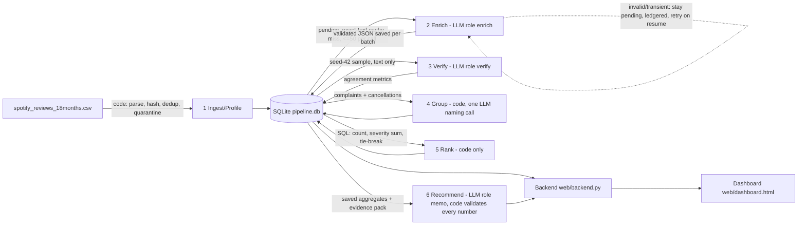

# MBA 290T Final - Multi-Agent Large Data Processing Pipeline
**Spotify reviews (660,622 rows, 18 months) -> product priority recommendation**

- Author: Kim Saiyo (@aksaiyo)
- Course: MBA 290T Fundamentals of Agentic AI, Assignment 5
- Source data: [Spotify dataset ZIP](https://drive.google.com/file/d/1P0rUoAS_wVjp3BYKqXMEyD4u0uJP1Bvf/view?usp=drivesdk)
- Source file: `spotify_reviews_18months.csv`, 97,400,616 bytes, sha256 `1fc85de68a304dd8978b537cfa58793d5f41cbaf417fa32cb53899f83a2fcef6`
- Live dashboard: not deployed yet (run `PIPELINE_DB=runs/pipeline.db python3 web/backend.py`, then open http://localhost:8080)

## 1. What this is
A coordinated multi-role pipeline that ingests 660,622 Spotify app-store reviews, classifies
each nonempty review (topic, intent, sentiment, severity, entities, evidence quote), verifies a
sample independently, groups complaints into issues, ranks them deterministically, and writes a
decision memo advising Spotify where next quarter's product effort should go.

Scope decision: **at least 100,000 classified reviews**, the floor the assignment page states
("all 660,622 (or at least 100,000)"), chosen to stay under the course's $10 API budget; the
grading contract's own illustration puts a full 660K run at $41-56 and our measured projection
is ~$23. The pipeline is resumable, so remaining rows can be added later as a resume phase
without re-paying for completed IDs.

## 2. Architecture and why each model call exists
| Stage | Owner | Model call? | Why |
|---|---|---|---|
| ingest/profile | code (SQL/Python) | no | deterministic parsing, hashing, dedup |
| enrich/classify | LLM role `enrich` | yes | semantic labels from review text; stars/metadata cannot substitute |
| verify | LLM role `verify` | yes (sample) | independent check of a deterministic sample; catches label drift |
| group | code + one LLM naming call | mostly no | issue grouping is deterministic; the model only names clusters from bounded examples |
| rank | code (SQL) | no | counts, mean severity, priority score, stable tie-break |
| memo | LLM role `memo` | yes | prose from saved aggregates + bounded evidence pack only; code validates every cited ID/number |


### Architecture diagram

Spend control: every call is written to a ledger table before and after; a shared budget stops admission at $9.00.

Exact-text cache: 484,189 distinct nonempty texts among 660,609 nonempty rows, so duplicate
rows are filled from cache at zero cost (recorded with `cache_source_id`, never reported as
new API calls).

## 3. Setup
```bash
python3 -m venv .venv && . .venv/bin/activate
pip install -r requirements.txt
cp .env.example .env   # fill OPENAI_API_KEY locally; never commit .env
```
Clean-environment checks a reviewer can run without any API key:
- `python3 cost/calculator.py` (offline replay of pilot measurements and full-run estimates)
- `python3 pipeline/rank.py runs/pipeline.db runs` (recompute ranking from saved outputs; byte-identical)
- `python3 data/check_submission.py profile --full data/spotify_reviews_18months.csv --out /tmp/ingestion.json`
- Paid execution is always a separate explicit command (`pipeline/pilot.py`, `pipeline/classify.py`).

## 4. Data identity and ingestion
- `runs/ingestion_report.json`: rows 660,622; empty texts quarantined 13; missing app_version
  159,701; distinct nonempty texts 484,189; all match the assignment's expected values.
- `runs/data_manifest.json`: file name, bytes, sha256, ingest time.
- Row-level sha256 per source row; the grading export carries `source_sha256` per record.

## 5. Label definitions as applied
Common labels from GRADING_CONTRACT.md: topics access/usability/playback/downloads/catalog/
billing/support/other; intents cancellation > complaint > request > praise > unclear;
severity 1-5. Worked examples in the enrich prompt (`prompts/enrich_v1.md`).

## 6. Golden set and evaluation
- 50 hand-labeled reviews (labeled by the author, blind to model output):
  https://docs.google.com/spreadsheets/d/1IbtB_lo1V5RKwas8zQfyQG5gWTtNG6EG_Ey4dBgX1Yo
- Golden texts are in the classified corpus; golden answer labels are never model inputs.
- `evals/golden_eval.json`: per-case and per-field accuracy. Pending: the author's hand labels were not finished when this was written; run `python3 pipeline/eval_golden.py runs/pipeline.db` after labeling.
- Independent verifier procedure: deterministic sample (seed 42), verifier gets the original
  text + rubric, never the enricher's answer; code compares fields (`evals/verify_main-verify.json`).
- Planted-error and injection tests: `evals/awkward_tests.json` (6 offline + 2 live checks).
  Synthetic cases are marked and excluded from business aggregates.

## 7. Cost and runtime
- Pilot: 100 reviews, cold run then warm replay - `cost/pilot_calls.jsonl`,
  `cost/pilot_records.jsonl`, `cost/pilot_timing.json`.
- Calculator: `cost/calculator.py` + dated editable `cost/rates.csv`; offline by default.
- Measured per-review cost: 71.5 input + 74.9 output tokens = $0.0000446 per review (gpt-6-luna, reasoning none; $0.10/M in, $0.50/M out). Budget decision: hard stop $9.00 total spend. Final run spend: $4.39 in the ledger of the final DB, plus ~$0.36 from a first run whose sandbox was wiped (about $4.75 total, under the $10 cap).
- Full-run (660K) scenario from measured rates: about $23, which is over the $10 cap, so scope is the 100K floor. `python3 cost/calculator.py` replays this offline.

## 8. Interruption and resume
- Recording: `evals/full_run.typescript` (captured with `script`).
- `runs/checkpoint_before.json` / `runs/checkpoint_mid_interrupted.json` / `runs/checkpoint_after.json`.
- Resume sends zero already-completed IDs (verified in `evals/resume_demo.json`).

## 9. Results
- Quarantine: 13 empty_review_text (+ any unprocessed rows with reasons).
- `grading/` export per GRADING_CONTRACT v1 (run.json, ingestion.json, records.jsonl,
  membership.csv, ranking.csv, claims.csv, calls.jsonl).
- Ranking: `priority_score = severity_sum`, tie-break ascending issue_id; means 6-decimal
  ROUND_HALF_UP. Reproducible from saved membership + enriched tables.
- One traced review: `02ebf89c-b923-44b8-92d1-972df45c4ee7` (source sha256 prefix 362ca104642e): "What's with this new update... If we click a song, another song comes to play instead of what I wanted. Can't skip songs. Playlist ain't working. Ads all the time..." -> enrichment topic=usability, intent=complaint, severity=4, evidence quote (exact substring) "If we click a song , another song comes to play instead of what I wanted . Can't skip songs." -> membership in issue `usability-ads` -> that issue ranks #1 (3,809 complaints, severity sum 9,525) -> memo claims cite those numbers and list this review as evidence.
- Failed/ambiguous case: some reviews contain JSON blobs or instruction-like text that made the model run on past the schema and hit the 8,000-token output cap ("truncated at max_output_tokens"). Handling: the call is ledgered as invalid, retried once, then the reviews stay pending (counted as unprocessed, not silently dropped). A salvage parser keeps the first complete JSON object when the model only appends trailing junk. A synthetic injection test is in `pipeline/tests_awkward.py` (marked synthetic, excluded from aggregates).

## 10. Decision memo
`runs/memo.md`: priority issue, alternatives, representative review IDs, limitations.
Material numbers cite `grading/claims.csv` claim IDs and are validated by code against
saved calculations.

## 11. Dashboard
- Database: SQLite `runs/pipeline.db` (source of truth for the backend).
- Backend: `web/backend.py` (stdlib, serves /api/metrics, /api/issues, /api/memo from the DB).
- Dashboard: local run only so far - metrics shown match saved calculations; recommendations cite
  supporting metrics and evidence IDs.

## 12. Limitations and failure accounting
- Classified 100,538 of 660,609 nonempty reviews (15.2%). The other 560,071 are unprocessed by budget choice and 13 are empty text; the export marks them quarantined with reasons. About 330 attempted batches' reviews hit invalid model output twice and stayed pending.
- Independent verifier on a seed-42 sample of 500 (450 compared; one verifier batch failed): agreement topic 89.3%, intent 93.8%, severity 90.4%, sentiment MAE 0.065; 97 compared records had at least one disagreement. Verification is one model re-reading the text, not ground truth. Golden-set accuracy is pending the author's labels.
- Issue grouping is deterministic (topic plus most common entity); 4,868 issues, most are tiny, and only 43 got model-written names.
- Run history: a first run (about 9.7K records) was lost when the sandbox was wiped; the final run was rebuilt and re-run from scratch. A stall caused by VM suspension was fixed with a wall-clock request deadline.
Honest accounting: nonempty quarantines reduce the classified fraction.

## 13. Repo hygiene
No API keys in tracked files or history; `.env.example` blank; `.gitignore` excludes `.env`,
`runs/`, `data/`. Raw data is not committed; source link + checksum above.
